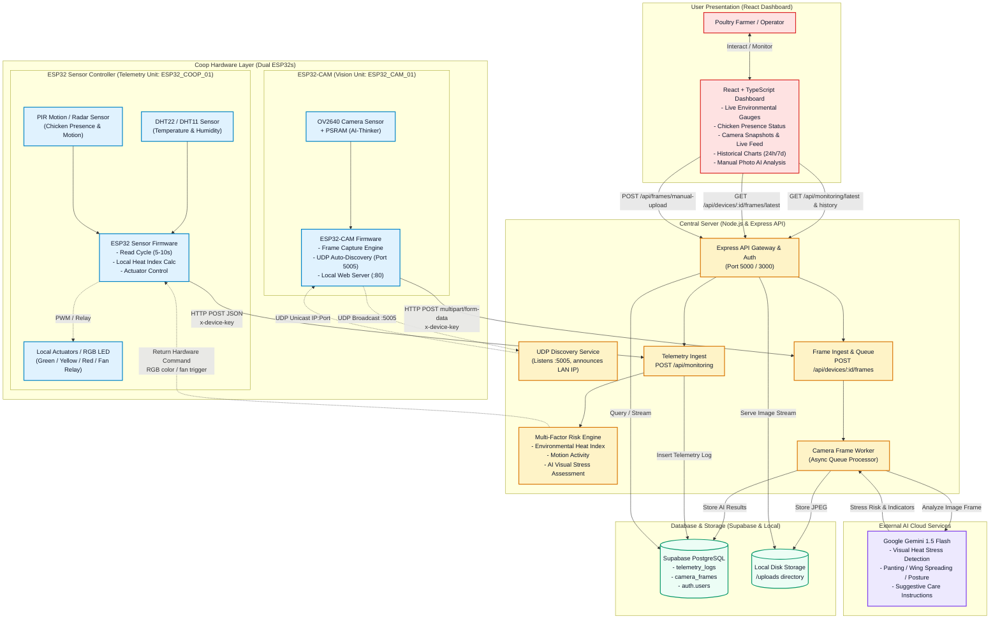
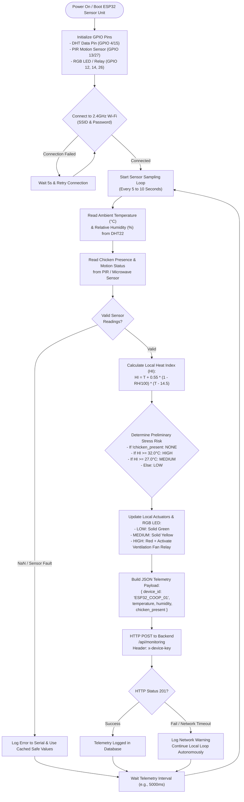
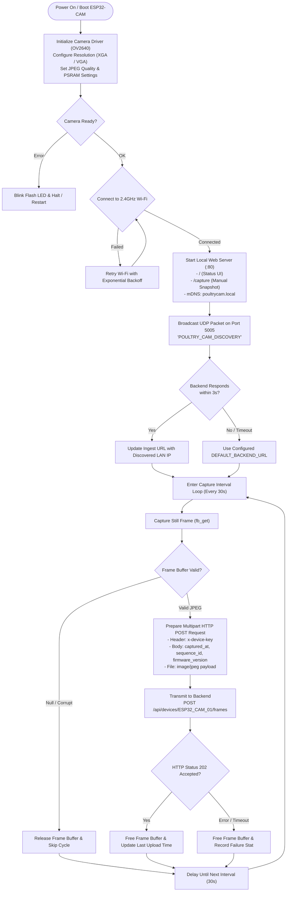
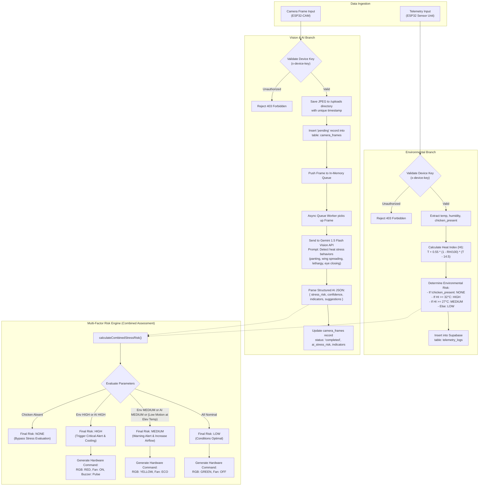
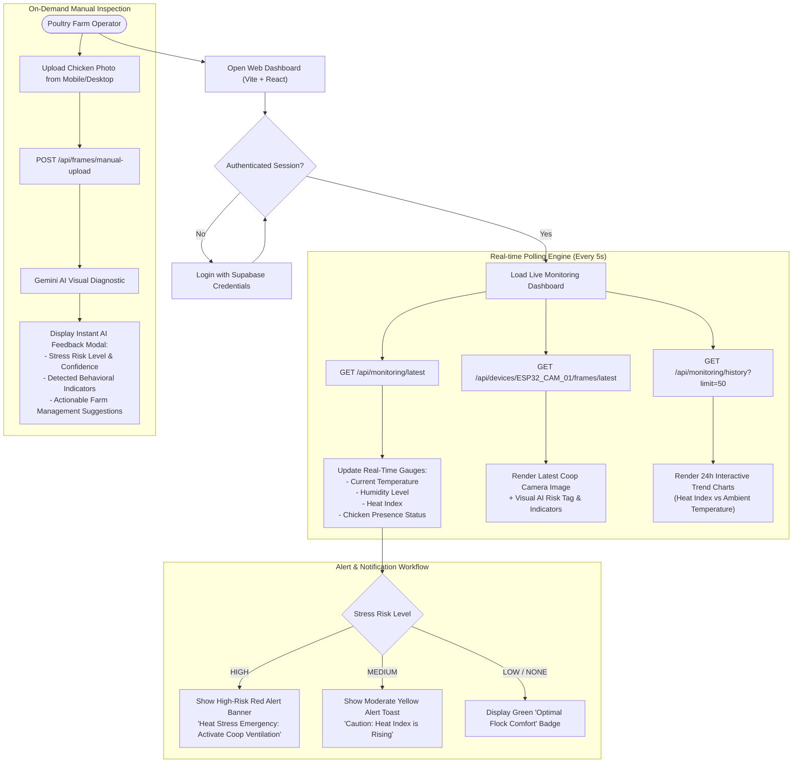

# Poultry Coop Monitoring System — Architecture & Flowcharts

This document outlines the complete operational workflow and data flow of the **Poultry Coop Monitoring System**, featuring a dual-ESP32 hardware architecture:
1. **ESP32-CAM (AI-Thinker)** — Dedicated to visual monitoring, image acquisition, and frame uploading.
2. **ESP32 Sensor Controller (ESP32-WROOM / NodeMCU)** — Dedicated to environmental sensing (temperature & humidity), chicken presence/motion detection, and local status indication/actuation.

---

## 1. High-Level System Architecture Flowchart



---

## 2. ESP32 Sensor Controller (`ESP32_COOP_01`) Flowchart

This microcontroller is stationed inside the coop to monitor environmental factors and flock presence.



### Sensor ESP32 Pinout & Component Allocation

| Component | Pin (Recommended) | Description |
| :--- | :--- | :--- |
| **DHT22 / DHT11** | `GPIO 4` | Ambient temperature and humidity data line with 10kΩ pull-up |
| **PIR Motion Sensor** | `GPIO 13` | Digital HIGH/LOW output indicating flock movement / presence |
| **RGB LED - Red** | `GPIO 12` | Active indicator for `HIGH` stress risk |
| **RGB LED - Green** | `GPIO 14` | Active indicator for `LOW` nominal risk |
| **RGB LED - Blue** | `GPIO 27` | Active indicator for status / Wi-Fi state |
| **Relay Module** | `GPIO 26` | Switches 12V/220V coop exhaust fan / cooling mister on `HIGH` risk |
| **Power Supply** | `5V / 2A (VIN)` | Regulated power supply for ESP32 and attached sensors |

---

## 3. ESP32-CAM (`ESP32_CAM_01`) Flowchart

This microcontroller is dedicated to image capture, frame streaming, and sending visual data for AI analysis.



---

## 4. Backend Processing & Multi-Factor Risk Fusion Flowchart

The Node.js/Express backend fuses telemetry from the Sensor ESP32 with visual inference from the ESP32-CAM.



---

## 5. Web Dashboard & User Interaction Flowchart



---

## 6. End-to-End Data Payloads & API Contracts

### A. Sensor Telemetry Payload (`ESP32_COOP_01` → Backend)
- **Endpoint**: `POST /api/monitoring`
- **Header**: `x-device-key: <DEVICE_INGEST_KEY>`, `Content-Type: application/json`

```json
{
  "device_id": "ESP32_COOP_01",
  "temperature": 33.5,
  "humidity": 68.2,
  "chicken_present": true
}
```

**Calculated by Backend & Saved to `telemetry_logs`:**
```json
{
  "id": 1042,
  "device_id": "ESP32_COOP_01",
  "temperature": 33.5,
  "humidity": 68.2,
  "heat_index": 39.8,
  "chicken_present": true,
  "stress_risk": "HIGH",
  "created_at": "2026-10-14T17:45:00.000Z"
}
```

---

### B. Camera Frame Ingest Payload (`ESP32_CAM_01` → Backend)
- **Endpoint**: `POST /api/devices/ESP32_CAM_01/frames`
- **Header**: `x-device-key: <DEVICE_INGEST_KEY>`, `Content-Type: multipart/form-data`
- **Form Fields**:
  - `captured_at`: ISO 8601 Timestamp
  - `sequence_id`: Sequence counter
  - `firmware_version`: `"esp32cam-static-1.3"`
  - `image`: Binary JPEG file (`image/jpeg`)

**Backend Response (202 Accepted):**
```json
{
  "success": true,
  "message": "Camera frame uploaded and queued for analysis.",
  "data": {
    "frameId": "3f4219b6-89d1-4475-ba7c-728b4081efbc",
    "deviceId": "ESP32_CAM_01",
    "status": "pending"
  }
}
```

---

### C. Gemini AI Visual Output Schema
```json
{
  "stress_risk": "HIGH",
  "confidence": 0.94,
  "indicators": [
    "Open-mouth panting",
    "Wings held away from body (drooping)",
    "Severe lethargy and crouching"
  ],
  "description": "Flock exhibits pronounced behavioral symptoms of severe heat stress.",
  "suggestions": [
    "Engage full exhaust fans and evaporative cooling pads immediately.",
    "Inspect water lines to guarantee cool, unrestricted drinking water.",
    "Dim coop lighting slightly to reduce flock activity."
  ]
}
```

---

### D. Combined Risk Evaluation (`POST /api/evaluate-risk`)
- **Combined Risk Logic**:
  - If `chicken_present == false` or `aiStressRisk == "NONE"` $\rightarrow$ `NONE`
  - If `heat_index >= 32.0` OR `aiStressRisk == "HIGH"` $\rightarrow$ `HIGH`
  - If `heat_index >= 27.0` OR `aiStressRisk == "MEDIUM"` OR `motionLevel == "LOW"` $\rightarrow$ `MEDIUM`
  - Otherwise $\rightarrow$ `LOW`

**Response Payload**:
```json
{
  "success": true,
  "timestamp": "2026-10-14T17:45:00.000Z",
  "data": {
    "sensorInputs": {
      "temperature": 33.5,
      "humidity": 68.2,
      "heatIndex": 39.8,
      "motionLevel": "LOW",
      "aiStressRisk": "HIGH"
    },
    "aiResult": {
      "stress_risk": "HIGH",
      "confidence": 0.94,
      "indicators": ["Open-mouth panting", "Wings drooping"]
    },
    "finalAssessment": {
      "finalStressRisk": "HIGH",
      "environmentalRisk": "HIGH",
      "evaluationSummary": "Critical ambient Heat Index detected. High observable behavioral stress indicators present in image."
    },
    "hardwareCommand": {
      "rgbIndicator": { "color": "RED", "red": 255, "green": 0, "blue": 0 }
    }
  }
}
```

---

## 7. System Component Matrix

| Subsystem | Hardware / Framework | Primary Responsibility | Data Transmission |
| :--- | :--- | :--- | :--- |
| **Vision Node** | AI-Thinker ESP32-CAM (OV2640) | Periodic snapshot capture, local web status, UDP discovery | Wi-Fi HTTP POST (JPEG multipart) |
| **Sensor Node** | ESP32 Dev Board (DHT22 + PIR) | Environmental monitoring, flock presence detection, local alerts | Wi-Fi HTTP POST (JSON telemetry) |
| **Backend API** | Node.js, Express, Multer | Device authentication, telemetry ingestion, frame queuing | REST API + UDP discovery broadcast |
| **AI Engine** | Google Gemini 1.5 Flash Vision | Multi-modal visual heat stress analysis and poultry diagnostics | REST API (Cloud JSON) |
| **Database** | Supabase (PostgreSQL) | Persistence for time-series telemetry, image metadata, auth | PostgREST / Supabase JS SDK |
| **Frontend** | React, TypeScript, Vite, Tailwind | Real-time dashboards, historical charting, manual photo upload | HTTP Polling (5s interval) |
